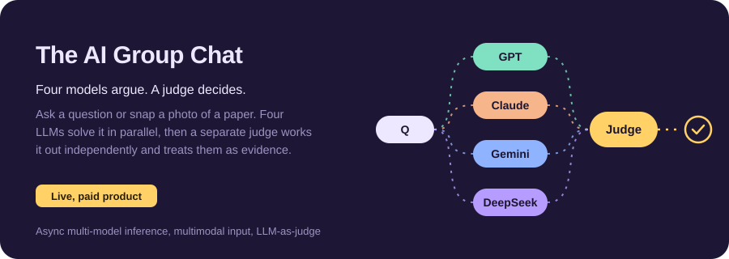
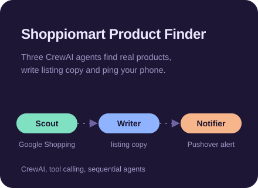
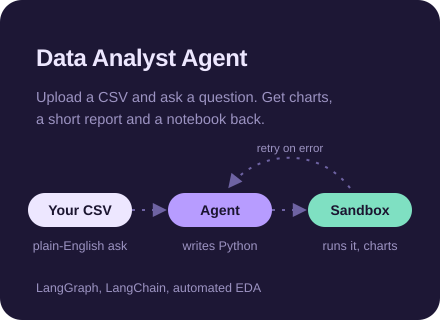

<p align="center">
  <a href="https://github.com/Mayankgupta1754/theaigroupchat">
    
  </a>
</p>

<p align="center">
  <a href="https://themayankgupta17.vercel.app/"></a>
  <a href="https://www.linkedin.com/in/mayank-gupta-218636253/"></a>
  <a href="mailto:themayankgupta17@gmail.com"></a>
</p>

<p align="center">
  B.Tech CSE at VIT Vellore. I build LLM apps, multi-agent systems and RAG pipelines in Python,<br>
  and I care most about getting them out of the notebook and into people's hands.
</p>

## What I'm building

<a href="https://github.com/Mayankgupta1754/theaigroupchat">
  
</a>

<a href="https://github.com/Mayankgupta1754/shoppiomart_recommender"></a> <a href="https://github.com/Mayankgupta1754/personal_data_analyst"></a>

## What I'm good at



<details>
<summary><b>See the full stack</b></summary>
<br>

**Languages** &nbsp;


**LLMs and agents** &nbsp;


**Machine learning and data** &nbsp;


**Shipping** &nbsp;


</details>

## How I got here



**Certifications:** AI Engineer Core Track (LLM engineering, RAG, QLoRA, agents) and AI Engineer Agentic Track (agents and MCP) on Udemy, plus Microsoft Certified: Azure AI Fundamentals.

**Right now I'm digging into** agentic RAG, LLM evaluation and reliability, MCP, and what it takes to run AI systems in production.

<details>
<summary><b>🔒 Do not open: my system prompt</b></summary>

```text
You are Mayank, an AI engineer.

- Ship the demo before the slide deck.
- When one model isn't sure, ask four. Then let a judge decide.
- Don't hallucinate. Link the repo.
- Low temperature for code, high temperature for ideas.
- If a junior asks a question, answer it twice: once simply, once properly.
- If the user is a recruiter, scroll up and click "Email me".
```

</details>

<br>

<picture>
  <source media="(prefers-color-scheme: dark)" srcset="https://raw.githubusercontent.com/Mayankgupta1754/Mayankgupta1754/output/github-contribution-grid-snake-dark.svg">
  
</picture>

<p align="center">
  
</p>
